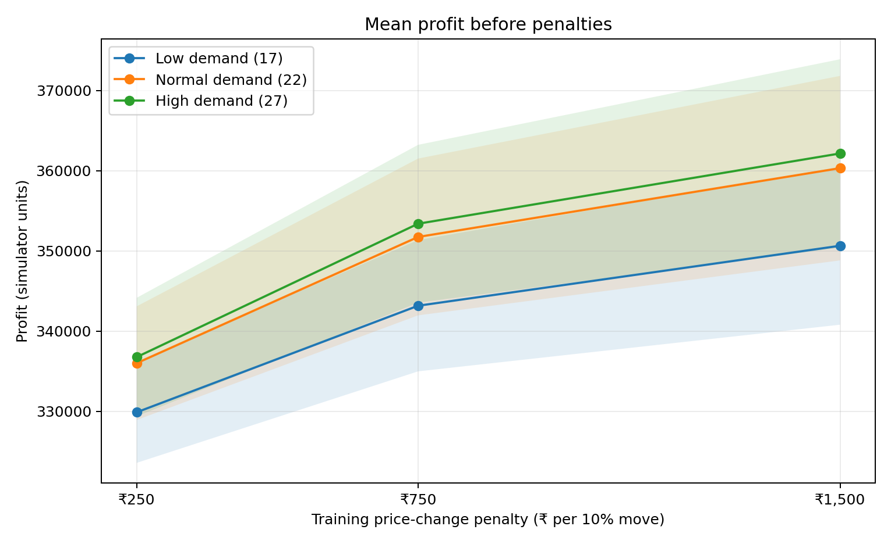
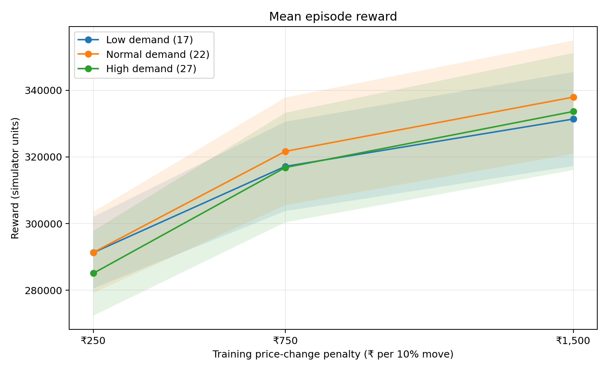
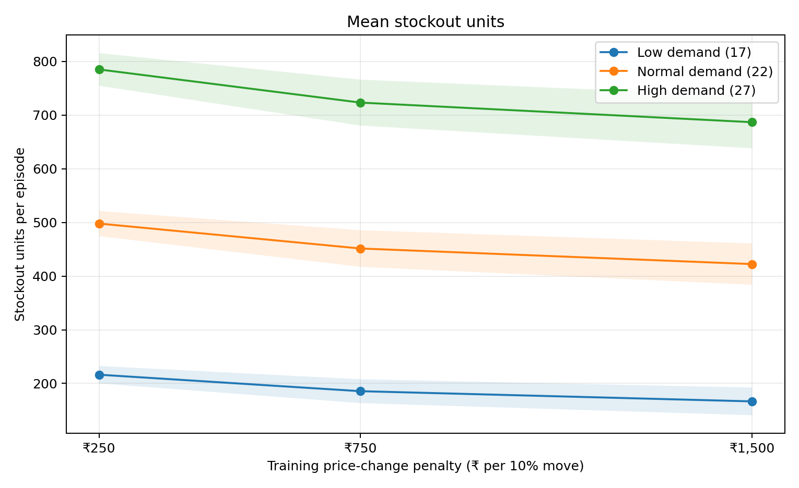
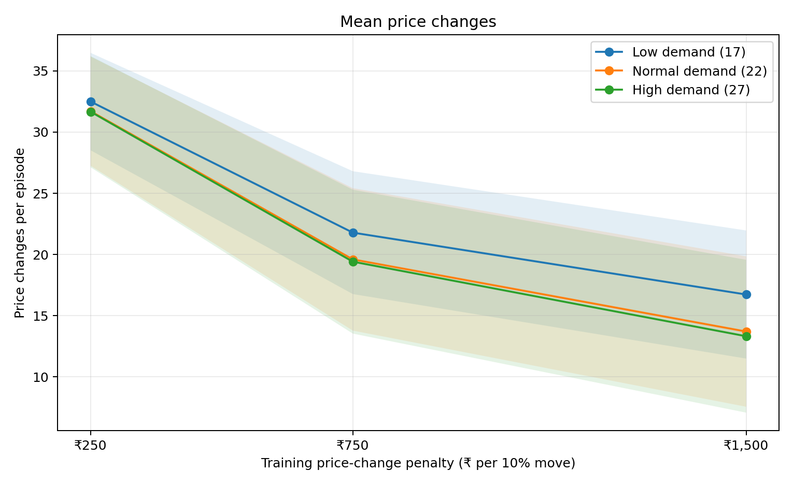

# RL-Based Dynamic Pricing System

A research-oriented reinforcement learning project that investigates how price-change penalties influence pricing decisions, simulated profit, inventory stockouts, and price stability in a synthetic retail environment.

The project implements a tabular Q-Learning agent and compares it with fixed-price, rule-based, and random policies across low-, normal-, and high-demand evaluation scenarios.

> **Research disclaimer:** This is a synthetic simulation for educational and experimental purposes. The results depend on the environment's assumptions and do not establish real-world retail profit improvements.

## Research Question

**How does the price-change penalty used during Q-Learning training affect simulated retail performance and pricing stability under different demand conditions?**

The experiments examine four key outcomes:

- Profit before penalties
- Total reward, including modeled costs and penalties
- Stockout units
- Number of price changes

## Features

- Synthetic retail demand influenced by price, competitor pricing, and a demand signal
- Inventory management, replenishment, holding costs, and stockout penalties
- Tabular Q-Learning with epsilon-greedy exploration
- Fixed-price, rule-based, and random baseline policies
- Experiments using three price-change penalties: ₹250, ₹750, and ₹1,500
- Low-, normal-, and high-demand evaluation scenarios
- Multiple training seeds and held-out evaluation episodes
- Paired comparisons with 95% confidence intervals
- CSV-based experimental results and visualizations
- Optional Streamlit dashboard
- Automated tests

## Technology Stack

- Python 3.11
- NumPy and pandas
- Matplotlib
- Streamlit
- pytest

## Project Structure

```text
rl-dynamic-pricing/
├── app/
│   └── dashboard.py
├── src/
│   ├── environment.py
│   ├── evaluation.py
│   ├── q_learning.py
│   └── baselines.py
├── reports/
│   └── final_analysis/
│       ├── analysis_report.md
│       ├── combined_per_seed_results.csv
│       ├── q_learning_summary_with_95ci.csv
│       ├── paired_penalty_comparisons.csv
│       ├── mean_profit_before_penalties_by_demand.png
│       ├── mean_reward_by_demand.png
│       ├── mean_stockout_units_by_demand.png
│       └── mean_price_changes_by_demand.png
├── results/
├── experiment_penalty.py
├── experiment_low_demand.py
├── experiment_demand.py
├── main.py
├── requirements.txt
└── README.md
```

The `results/` directory contains experiment-specific outputs. The `reports/final_analysis/` directory contains consolidated results and visualizations.

## Requirements

Python 3.11 is recommended. No API key, paid service, GPU, or external dataset download is required.

## Setup (Windows / VS Code)

Open a terminal in the project directory.

```powershell
py -3.11 -m venv .venv
.\.venv\Scripts\Activate.ps1
python -m pip install --upgrade pip
pip install -r requirements.txt
```

If PowerShell blocks activation, use Command Prompt instead:

```bat
.venv\Scripts\activate.bat
```

If Python 3.11 is not installed, use another supported Python version compatible with the dependencies.

## Train and Evaluate

Run the default training and evaluation workflow:

```powershell
python main.py
```

The default workflow saves outputs under `results/`, including files such as:

- `training_history.csv`
- `learning_curve.png`
- `evaluation_episodes.csv`
- `evaluation_details.csv`
- `evaluation_summary.csv`
- `q_table.csv`

Default training uses 1,200 episodes, and evaluation uses 50 episodes per policy. Exact outputs depend on the implementation and configuration.

## Reproduce the Demand Experiments

Run the three experimental scripts from the project root.

```powershell
python experiment_penalty.py
python experiment_low_demand.py
python experiment_demand.py
```

These scripts evaluate the effect of different training penalties under normal-, low-, and high-demand conditions, respectively. Check each script's configuration and output directory before running it, especially if you already have experiment results.

The consolidated analysis in `reports/final_analysis/` was generated from the experiment CSV files and can be inspected without rerunning training.

## Experimental Methodology

The experiments use:

- **Training penalties:** ₹250, ₹750, and ₹1,500
- **Training runs:** 20 seeds per penalty
- **Training duration:** 1,200 episodes per run
- **Evaluation:** 50 episodes per trained configuration
- **Evaluation policies:** Q-Learning, fixed price, rule-based, and random
- **Evaluation penalty:** ₹750 across the compared policies
- **Evaluation horizon:** 60 simulated days

The demand experiments use different evaluation demand settings:

| Demand condition | Evaluation base demand |
|---|---:|
| Low | 17 |
| Normal | 22 |
| High | 27 |

The evaluation scenarios are held out from training. The low- and high-demand experiments use a different evaluation seed from the normal-demand experiment, so comparisons across demand conditions should be interpreted descriptively rather than as fully matched scenario comparisons.

## Model Design

- **State:** Inventory band, coarse demand level, competitor-price relationship, and previous action
- **Actions:** Select 90%, 100%, or 110% of the ₹1,000 reference price
- **Reward:** Sales margin minus holding costs, stockout penalties, and price-change penalties
- **Agent:** Tabular Q-Learning with epsilon-greedy exploration
- **Baselines:** Fixed-price, rule-based, and random policies

The environment models simplified retail behavior. Its outputs are determined by the assumptions and parameters encoded in the simulator.

## Experimental Results

The following table summarizes the Q-Learning results averaged across 20 training seeds for each penalty. Profit is measured before the modeled holding, stockout, and price-change penalties are deducted from the reward.

| Demand | Training penalty | Mean profit before penalties | Mean reward | Mean stockout units | Mean price changes |
|---|---:|---:|---:|---:|---:|
| Low | ₹250 | ₹329,887.60 | ₹291,270.81 | 216.32 | 32.50 |
| Low | ₹750 | ₹343,173.00 | ₹317,167.11 | 185.61 | 21.79 |
| Low | ₹1,500 | ₹350,653.90 | ₹331,384.77 | 166.59 | 16.73 |
| Normal | ₹250 | ₹336,012.50 | ₹291,341.40 | 497.91 | 31.71 |
| Normal | ₹750 | ₹351,752.10 | ₹321,685.94 | 451.48 | 19.60 |
| Normal | ₹1,500 | ₹360,335.40 | ₹337,969.30 | 422.41 | 13.71 |
| High | ₹250 | ₹336,773.20 | ₹285,076.64 | 785.05 | 31.67 |
| High | ₹750 | ₹353,402.20 | ₹316,825.58 | 723.31 | 19.42 |
| High | ₹1,500 | ₹362,168.50 | ₹333,651.67 | 686.77 | 13.32 |

### Key Observations

1. **Higher training penalties were associated with fewer price changes.** This pattern appeared in all three demand conditions.
2. **Mean reward and profit before penalties increased with the training penalty** in the reported averages.
3. **Stockout units decreased as the training penalty increased** in the reported averages, although the penalty directly discourages price changes rather than directly minimizing stockouts.
4. **The ₹1,500 penalty produced the strongest observed averages** for these four metrics in this experiment. However, the observed ranking alone is not sufficient to establish that it is statistically superior to ₹750.

These are descriptive findings from the reported simulation runs, not guarantees about other environments or actual retail markets.

## Statistical Analysis

The consolidated analysis includes paired comparisons between training penalties using seed-level Q-Learning results and 95% Student's t confidence intervals.

The comparisons provide additional context beyond comparing means:

- The ₹750 versus ₹250 comparison showed favorable paired differences in reward, profit before penalties, stockouts, and price changes in both the low- and high-demand experiments.
- The ₹1,500 versus ₹750 comparisons had confidence intervals that included zero for these four metrics in the low- and high-demand experiments. The observed improvements therefore remain statistically uncertain under these comparisons.
- The ₹1,500 versus ₹250 comparisons showed favorable paired differences across these four metrics in both the low- and high-demand experiments.

The reported intervals are unadjusted for multiple comparisons. Confidence intervals describe uncertainty across the simulated training seeds; they do not account for every possible source of model uncertainty or establish external validity.

See [`paired_penalty_comparisons.csv`](reports/final_analysis/paired_penalty_comparisons.csv) for the detailed comparisons.

## Visualizations

### Mean Profit Before Penalties



### Mean Reward



### Mean Stockout Units



### Mean Price Changes



## Detailed Reports and Data

- [Full experimental analysis](reports/final_analysis/analysis_report.md)
- [Combined per-seed results](reports/final_analysis/combined_per_seed_results.csv)
- [Q-Learning summary with 95% confidence intervals](reports/final_analysis/q_learning_summary_with_95ci.csv)
- [Paired penalty comparisons](reports/final_analysis/paired_penalty_comparisons.csv)

The CSV files support further analysis of individual seeds, policies, and penalty settings.

## Run the Dashboard

```powershell
streamlit run app/dashboard.py
```

Open the local URL printed by Streamlit. Use the sidebar to configure training and evaluation, then select **Train and evaluate**.

## Run Tests

```powershell
python -m pytest -q
```

The current test suite contains five tests. Run the command to verify that the tests still pass in your environment.

## Limitations

- The retail market and its results are simulated, not derived from a validated real-world retail dataset.
- Demand, competitor pricing, inventory behavior, and price elasticity are simplified.
- Cost values and penalties are illustrative parameters.
- Results depend on the state representation, available actions, reward function, hyperparameters, and random seeds.
- The cross-demand experiments use different evaluation seeds.
- The reported confidence intervals do not eliminate model uncertainty or prove real-world effectiveness.
- Profit before penalties is not the same as the reward objective optimized by the agent.

## Future Work

- Compare Q-Learning against stronger baselines and alternative reinforcement learning algorithms.
- Test sensitivity to demand elasticity, inventory constraints, competitor behavior, and stockout costs.
- Evaluate across additional independently generated scenarios.
- Improve statistical analysis and consider corrections for multiple comparisons.
- Investigate calibrated demand models and historical data where appropriate.
- Explore Deep Q-Networks (DQN) if the state space and experimental goals justify the added complexity.

## Conclusion

This project provides a reproducible experimental framework for examining the relationship between pricing stability and simulated retail performance. Across the tested demand conditions, higher price-change penalties were associated with fewer price changes and improved average outcomes. Paired confidence intervals show why these observations should be interpreted carefully, especially when comparing the two higher penalty settings.

The main contribution is the experimental framework, baseline comparison, multi-seed evaluation, and transparent reporting of both results and limitations.
